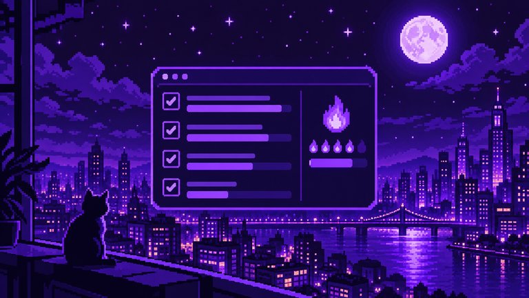
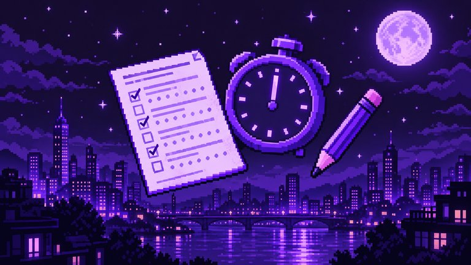
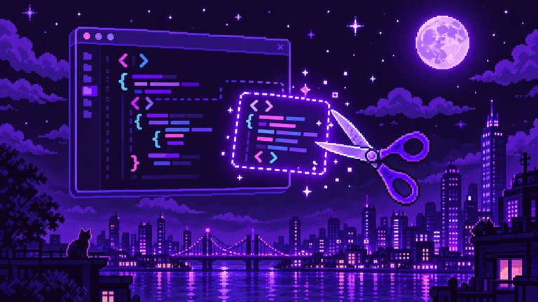

## ◆ About Me

Computer Science (CSE) student at University College of Engineering, Panruti (Anna University). I build full-stack web apps and AI-powered tools, from idea to live deployment.

**Open to:** fresher software developer roles, internships and freelance work

## ◆ Featured Projects

| | Project | About | Links |
|---|---------|-------|-------|
|  | **TrackMate** | Full-stack productivity and progress tracker: tasks, goals, habit streaks, analytics dashboards, calendar view. Next.js 16, TypeScript, Supabase (PostgreSQL + Auth, RLS). | [Repo](https://github.com/SivaJenani/TrackMate) · [Live demo](https://trackmate-app-two.vercel.app) |
|  | **RankArc** | Turns previous-year competitive exam papers (NEET, JEE Main, SSC CGL) into timed mock tests. FastAPI, React, PostgreSQL, Redis, Docker. | [Repo](https://github.com/SivaJenani/RankArc) · [Live demo](https://rankarc.onrender.com) |
|  | **NextStep AI** | AI career guidance and job recommendation app: resume analysis, skill-gap scoring, ML job ranking, 30/60/90-day roadmaps, mentor chatbot. FastAPI + React. | [Repo](https://github.com/SivaJenani/NextStep-AI-Final-) · [Live demo](https://nextsteppro.in) |
|  | **Sniplet** | Code snippet manager: Next.js, Prisma, PostgreSQL full-text search, Claude API for auto-tagging and explanations (in progress) | [Repo](https://github.com/SivaJenani/Sniplet) |
|  | **AspirePrep** | MERN exam-prep platform with Gemini-powered AI help | [Repo](https://github.com/SivaJenani/AspirePrep) |
|  | **NoteStore** | E-commerce for digital study notes and exam PDFs. React, TypeScript, Express, JWT | [Repo](https://github.com/SivaJenani/NoteStore) |

## ◆ Tech Stack

**✧ Frontend**

React · Next.js · TypeScript · Tailwind CSS

**✧ Backend**

Node.js · Express · FastAPI

**✧ Databases**

PostgreSQL · Supabase · MongoDB · Prisma

**✧ Tools**

Docker · Vercel · Render · Figma

**AI / APIs:** `Gemini, Claude, OpenAI`

## ◆ GitHub Stats

## ◆ Connect

