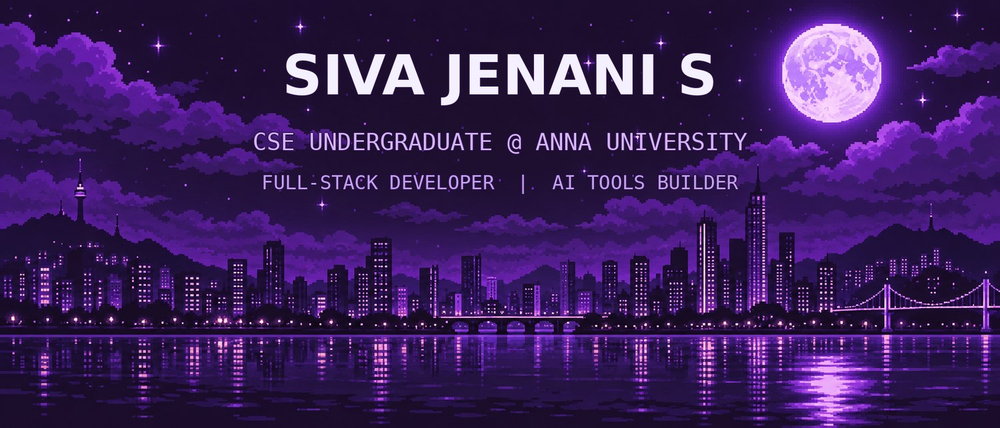

## About Me

Computer Science (CSE) student at University College of Engineering, Panruti (Anna University). I build full-stack web apps and AI-powered tools, from idea to live deployment.

**Open to:** fresher software developer roles, internships and freelance work.

## Projects

- **[TrackMate](https://github.com/SivaJenani/TrackMate)** ([live demo](https://trackmate-app-two.vercel.app)): Full-stack productivity and progress tracker with tasks, goals, habit streaks, analytics dashboards and a calendar view. Next.js 16, TypeScript, Supabase (PostgreSQL + Auth, RLS).
- **[RankArc](https://github.com/SivaJenani/RankArc)** ([live demo](https://rankarc.onrender.com)): Turns previous-year competitive exam papers (NEET, JEE Main, SSC CGL) into timed mock tests. FastAPI, React, PostgreSQL, Redis, Docker.
- **[NextStep AI](https://github.com/SivaJenani/NextStep-AI-Final-)** ([live demo](https://nextsteppro.in)): AI career guidance and job recommendation app with resume analysis, skill-gap scoring, ML job ranking, 30/60/90-day roadmaps and a mentor chatbot. FastAPI + React.
- **[Sniplet](https://github.com/SivaJenani/Sniplet)**: Code snippet manager with Next.js, Prisma, PostgreSQL full-text search and Claude API for auto-tagging and explanations (in progress).
- **[AspirePrep](https://github.com/SivaJenani/AspirePrep)**: MERN exam-prep platform with Gemini-powered AI help.
- **[NoteStore](https://github.com/SivaJenani/NoteStore)**: E-commerce for digital study notes and exam PDFs. React, TypeScript, Express, JWT.

## Tech Stack

- **Frontend:** React, Next.js, TypeScript, Tailwind CSS
- **Backend:** Node.js, Express, FastAPI
- **Databases:** PostgreSQL, Supabase, MongoDB, Prisma
- **Tools:** Docker, Vercel, Render, Figma
- **AI / APIs:** Gemini, Claude, OpenAI

## Connect

- LinkedIn: [siva-jenani-s](https://www.linkedin.com/in/siva-jenani-s-aa665b2bb)
- Email: [sivajenanis@gmail.com](mailto:sivajenanis@gmail.com)
